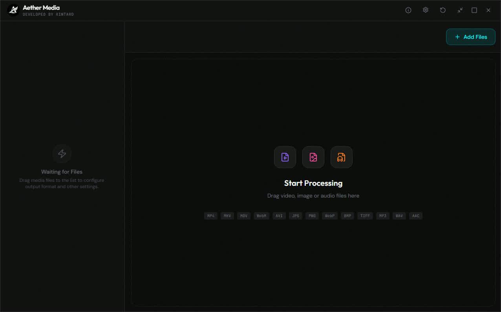
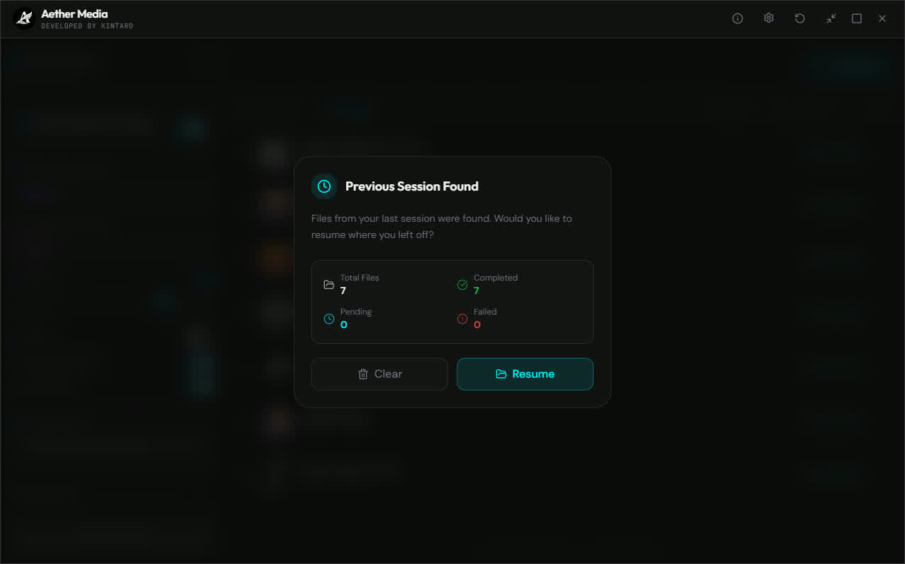

<a href="README.md">
  
</a>

<a href="README-TR.md">
  
</a>

  <br />
  <br />

<div align="center">
  

  <br />
  <br />

  <p>
    Modern, Hızlı ve Güçlü Toplu Medya İşleme Aracı
  </p>


  <p>
    <a href="#features">Özellikler</a> •
    <a href="#tech">Teknolojiler</a> •
    <a href="#installation">Kurulum</a> •
    <a href="#project-structure">Proje Yapısı</a> •
    <a href="#license">Lisans</a> •
    <a href="#gallery">Galeri</a>
  </p>

  <br />
  <br />
</div>


## ⚠️ UYARI

> Bu dökümanı projenin 1.0.0 sürümü için yazmıştım. kalite ayarlama mantığını değiştirdim. bir çok hatayı giderdim. ve çok yararlı yeni özellikler ekledim. ama yeni bir döküman yazmaya vaktim olmadı. aslında dökümanda zaten fazla teknik bilgi yada aşırı ihtiyaç duyacağınız bir bilgilendirme yok. programı çalıştırır çalıştırmaz neyin ne olduğunu kolayca anlayabilirsiniz.
>
> Bu Uyarıyı Yazdığım Tarih: 08 Mayıs 2026 

## 📋 Hakkında

**Aether Media**, kullanıcıların medya dosyalarını (video, ses, görsel) toplu olarak hızlı, güvenli ve kolay bir şekilde dönüştürmelerini, sıkıştırmalarını, boyutlandırmalarını ve yeniden isimlendirmelerini sağlayan bir medya işleme aracıdır.

**Rust** dilinin performansı ve **Tauri**'nin hafif yapısı üzerine inşa edilmiştir. Video ve ses işlemleri için **FFmpeg**, görsel dönüştürme, boyutlandırma ve küçük resim oluşturma için **ImageMagick** kullanır; bu işlemleri modern bir arayüzde bir araya getirir. Dosyalarınız asla bir sunucuya yüklenmez; tüm işlemler tamamen yerel olarak kendi cihazınızda gerçekleşir.



## ✨ Özellikler <a id="features"></a>

### Geniş Format Desteği
Aether Media tüm popüler medya formatlarını destekler:
- **Video**: `MP4`, `MKV`, `MOV`, `WEBM`
- **Ses**: `MP3`, `AAC`, `M4A`, `OGG`
- **Görsel**: `JPG`, `PNG`, `WEBP`

### Akıllı Dönüştürme
- **Kalite Kontrolü**: %0 ile %100 arasında hassas kalite ayarı. Video dönüştürmeleri için otomatik **CRF (Constant Rate Factor)** hesaplaması ile en iyi boyut/kalite dengesini sunar.
- **Ses Ayrıştırma**: Video dosyalarından sadece ses akışını ayıklayabilme ve MP3, WAV veya AAC formatına dönüştürebilme.
- **Toplu İşleme**: Aynı anda birden fazla dosyayı kuyruğa ekleme ve bunları sırasıyla işleme.

### Gelişmiş Yeniden Boyutlandırma
Görseller ve videolar için güçlü yeniden boyutlandırma seçenekleri:
- **Fit (Sığdır)**: En boy oranını koruyarak belirtilen alana sığdırır.
- **Cover (Kapa)**: En boy oranını koruyarak alanı tamamen doldurur (fazlalıklar kırpılır).
- **Stretch (Uzat)**: Görüntüyü belirtilen boyutlara sığacak şekilde uzatır.
- **Arka Plan Rengi**: Sığdırma işlemleri sırasında oluşan boşluklar için **Siyah**, **Beyaz** veya **Şeffaf** (PNG/WebM için) arka plan seçeneği.

### Dosya İsimlendirme Yönetimi
Çıktı dosyalarınızı organize etmek artık çok kolay:
- **Önek (Prefix)** ekleme.
- **Tarih/Saat** damgası ekleme.
- **Rastgele** karakterlerle benzersiz isimlendirme.
- **Orijinal** ismi koruma.
- **Temizleme**: Dosya isimlerindeki geçersiz karakterleri ve boşlukları isteğe göre otomatik olarak temizler.

### Modern Kullanıcı Deneyimi
- **Sürükle & Bırak**: Dosyaları uygulamanın üzerine bırakarak anında işlemeye başlayın.
- **Karanlık Mod**: Göz dostu, şık ve modern arayüz.
- **İlerleme Takibi**: Her dosya için anlık durum, ilerleme çubuğu ve detaylı hata raporlama.
- **Dosya Başına Ayar**: Kuyruktaki her dosya için dönüştürme ayarlarını bireysel olarak özelleştirin.

### Güvenli ve Akıllı Oturum Yönetimi
- **Oturum Kurtarma**: Uygulama beklenmedik bir şekilde kapansa bile, kuyruktaki dosyalarınız ve ayarlarınız kaybolmaz. Uygulamayı tekrar açtığınızda kaldığınız yerden devam edebilirsiniz.
- **İşlem Kontrolü**: Devam eden işlemleri **Duraklat**, **Devam Et** veya **İptal Et** seçenekleriyle anlık olarak yönetin.

### Toplu İşleme ve Hızlı Erişim
- **Gelişmiş Çoklu Seçim**: Windows gezgini benzeri `Ctrl + Tık` ve `Ctrl + A` kısayolları ile dosyaları toplu yönetin.
- **Hata Yönetimi**: Başarısız olan dosyaları tek tıkla tekrar kuyruğa alın veya temizleyin.
- **Sürükle & Bırak Bölgesi**: Uygulama içindeki boş bir alana veya özel bırakma bölgesine sürükleyerek hızlıca dosya ekleyin.

## <a id="tech"></a>🛠️ Teknolojiler

Proje, en güncel ve performans odaklı teknolojiler kullanılarak geliştirilmiştir:

### Backend (Rust & Tauri)
- **Tauri**: Yerel sistem özelliklerine erişim sağlayan ultra hafif ve güvenli çerçeve.
- **Rust**: Bellek güvenliği ve yüksek performans sunan sistem programlama dili.
- **Tokio**: Asenkron çalışma zamanı ile bloklanmayan, akıcı işlem yönetimi.
- **FFmpeg**: Video ve ses dönüştürme, kodlama ve ses ayrıştırma.
- **ImageMagick**: Görsel dönüştürme, boyutlandırma ve küçük resim oluşturma.

### Frontend (React & TypeScript)
- **React 19**: En yeni React özellikleri ile hızlı kullanıcı arayüzü oluşturma.
- **Vite**: Işık hızında geliştirme ve derleme aracı.
- **Tailwind CSS**: Modern ve esnek stil tanımlamaları.
- **Zustand + Immer**: Optimize edilmiş değişmez güncellemelerle basit ve güçlü global durum yönetimi.
- **Framer Motion**: Akıcı animasyonlar ve geçişler.
- **TanStack Virtual**: Binlerce dosyalık listelerde bile yüksek performanslı kaydırma.
- **Radix UI**: Erişilebilir ve özelleştirilebilir bileşenler.

## 🚀 Kurulum <a id="installation"></a>

Projeyi yerel ortamınızda çalıştırmak veya geliştirmek için aşağıdaki adımları izleyin.

### Gereksinimler
- **Node.js** (v18+)
- **Rust** (en son kararlı sürüm)
- **FFmpeg** ve **ImageMagick**: Her iki motor da proje içinde `src-tauri/binaries` altına yerleştirilmelidir (3. adıma bakın).

### Adım Adım Kurulum

1.  **Depoyu Klonlayın**
    ```bash
    git clone https://github.com/xkintaro/aether-media.git
    cd aether-media
    ```

2.  **Bağımlılıkları Yükleyin**
    ```bash
    npm install
    ```

3.  **Medya Motorlarını Yapılandırın (Windows x64)**
    - `src-tauri/binaries` dizini yoksa oluşturun. Tauri yapılandırması, geliştirme ve derleme için her iki motoru da gerektirir.
    - **FFmpeg**: [BtbN/FFmpeg-Builds](https://github.com/BtbN/FFmpeg-Builds/releases) üzerinden Windows x64 için GPL lisanslı **statik** bir derleme indirin. Arşivdeki `ffmpeg.exe` dosyasını çıkarıp `ffmpeg-x86_64-pc-windows-msvc.exe` olarak yeniden adlandırın.
    - **ImageMagick**: [Resmî indirme sayfasından](https://imagemagick.org/download/) Windows x64 için **taşınabilir statik** bir arşiv (`portable-Q16-x64.7z` gibi) indirin. Arşivi çıkarın, `magick.exe` dosyasını `magick-x86_64-pc-windows-msvc.exe` olarak yeniden adlandırın ve arşivdeki yardımcı yapılandırma dosyalarını yanında tutun.
    - Çalıştırılabilir dosyaları aşağıdaki tam yollarla yerleştirin; hedef platform son eki Tauri tarafından gereklidir:

      ```text
      src-tauri/binaries/ffmpeg-x86_64-pc-windows-msvc.exe
      src-tauri/binaries/magick-x86_64-pc-windows-msvc.exe
      ```

    - Proje kök dizininde PowerShell ile iki motoru da doğrulayın:

      ```powershell
      .\src-tauri\binaries\ffmpeg-x86_64-pc-windows-msvc.exe -version
      .\src-tauri\binaries\magick-x86_64-pc-windows-msvc.exe -version
      ```

    - Motor dosyaları Git tarafından yok sayılır; depoyu klonladıktan sonra ayrıca indirilmelidir.

4.  **Uygulamayı Başlatın**
    ```bash
    npm run tauri dev
    ```

### Derleme

Uygulama için dağıtılabilir bir `.exe` yükleyicisi oluşturmak için:

```bash
npm run tauri build
```
Çıktı dosyaları `src-tauri/target/release/bundle/nsis` dizininde oluşturulacaktır.

## 📂 Proje Yapısı <a id="project-structure"></a>

```
aether-media/
├── src/                        # Frontend (React + TypeScript)
│   ├── components/
│   ├── hooks/
│   ├── lib/
│   ├── store/
│   └── types/
├── src-tauri/                  # Backend (Rust + Tauri)
│   ├── src/
│   │   ├── modules/
│   │   │   ├── ffmpeg.rs       # FFmpeg komut oluşturucu
│   │   │   ├── imagemagick.rs  # ImageMagick komut oluşturucu
│   │   │   ├── naming.rs       # Dosya isimlendirme mantığı
│   │   │   └── thumbnail.rs    # Thumbnail oluşturma
│   │   ├── commands.rs
│   │   ├── error.rs
│   │   ├── state.rs
│   │   └── types.rs
│   ├── binaries/               # FFmpeg ve ImageMagick (depoya dahil değildir)
│   │   ├── ffmpeg-x86_64-pc-windows-msvc.exe
│   │   └── magick-x86_64-pc-windows-msvc.exe
│   └── tauri.conf.json
└── public/
```

## <a id="license"></a>📄 Lisans

Bu proje **GNU General Public License v3.0** kapsamında lisanslanmıştır. detaylar için [LICENSE](LICENSE) dosyasına bakın.

Bu proje, yine GPL v3 kapsamında dağıtılan **FFmpeg**'i barındırır. Daha fazla bilgi için [ffmpeg.org/legal.html](https://ffmpeg.org/legal.html) adresini ziyaret edin.

## 🖼️ Galeri <a id="gallery"></a>



#


#


#

<p align="center">
  <sub>❤️ Developed by "Mustafa TAŞAL" (kintaro)</sub>
</p>
